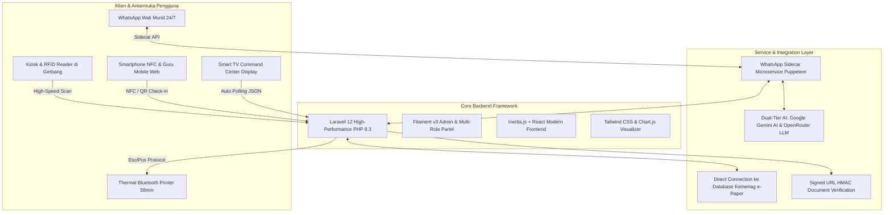
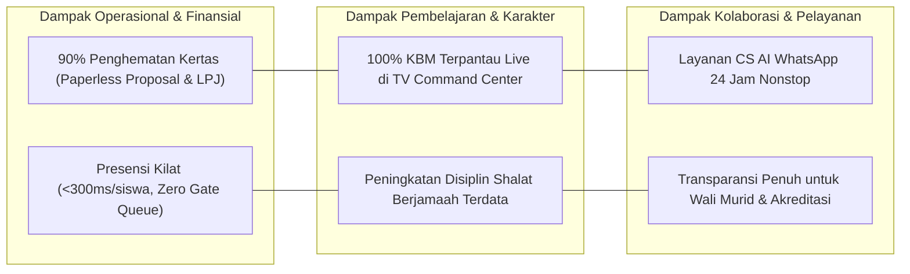

# LAPORAN INOVASI DAN FITUR UNGGULAN APLIKASI SIGMA-3
## Transformasi Ekosistem Digital Terpadu Madrasah Menuju Smart School 5.0
**Disusun untuk: Acer Smart School Awards (ASSA) / Acer School of the Year**  
**Lembaga: MTsN 3 Tulungagung (MATSANEGA), Jawa Timur**  
**Versi Sistem: SIGMA-3 Enterprise v4.0**  
**Tahun Implementasi: 2026**

---

## DAFTAR ISI
1. [Ringkasan Eksekutif](#1-ringkasan-eksekutif)
2. [Latar Belakang & Urgensi Inovasi](#2-latar-belakang--urgensi-inovasi)
3. [Arsitektur Teknologi & Landasan Sistem](#3-arsitektur-teknologi--landasan-sistem)
4. [Daftar Lengkap & Analisis Fitur Unggulan SIGMA-3](#4-daftar-lengkap--analisis-fitur-unggulan-sigma-3)
   - 4.1. [Smart Gate & Holistic Presence (Presensi RFID & Web NFC)](#41-smart-gate--holistic-presence-presensi-rfid--web-nfc)
   - 4.2. [Pembiasaan Karakter & Presensi Ubudiyah Digital](#42-pembiasaan-karakter--presensi-ubudiyah-digital)
   - 4.3. [Live KBM Monitoring & TV Display Command Center](#43-live-kbm-monitoring--tv-display-command-center)
   - 4.4. [Presensi Guru di Kelas via Dynamic QR Code](#44-presensi-guru-di-kelas-via-dynamic-qr-code)
   - 4.5. [SIGMA-3 Student Intelligence & 360° Holistic Profiling](#45-sigma-3-student-intelligence--360-holistic-profiling)
   - 4.6. [Integrasi Langsung Basis Data e-Rapor Kementerian Agama](#46-integrasi-langsung-basis-data-e-rapor-kementerian-agama)
   - 4.7. [24/7 CS AI Matsanega (Dual-Tier Google Gemini & Fallback LLM)](#47-247-cs-ai-matsanega-dual-tier-google-gemini--fallback-llm)
   - 4.8. [WhatsApp Automation Sidecar Microservice](#48-whatsapp-automation-sidecar-microservice)
   - 4.9. [Parent Portal & Anti-Fraud Digital Leave System](#49-parent-portal--anti-fraud-digital-leave-system)
   - 4.10. [Dispensasi & Thermal Bluetooth Slip Printing](#410-dispensasi--thermal-bluetooth-slip-printing)
   - 4.11. [Paperless Multi-Tier Governance: Proposal & LPJ Kegiatan](#411-paperless-multi-tier-governance-proposal--lpj-kegiatan)
   - 4.12. [Generator Otomatis Laporan Bulanan Ekstrakurikuler](#412-generator-otomatis-laporan-bulanan-ekstrakurikuler)
   - 4.13. [Bimbingan Konseling (BK) & Penegakan Disiplin Positif](#413-bimbingan-konseling-bk--penegakan-disiplin-positif)
   - 4.14. [Manajemen Akademik, Perangkat Ajar & Umpan Balik Guru](#414-manajemen-akademik-perangkat-ajar--umpan-balik-guru)
   - 4.15. [Role-Based Access Control (RBAC) & Dasbor Khusus 10+ Peran](#415-role-based-access-control-rbac--dasbor-khusus-10-peran)
   - 4.16. [Portal Siswa Mandiri (Student Dashboard)](#416-portal-siswa-mandiri-student-dashboard)
   - 4.17. [Keamanan Dokumen Digital dengan HMAC Verification QR](#417-keamanan-dokumen-digital-dengan-hmac-verification-qr)
5. [Matriks Peran Pengguna (User Matrix)](#5-matriks-peran-pengguna-user-matrix)
6. [Dampak & Manfaat Implementasi (Key Impact & Value)](#6-dampak--manfaat-implementasi-key-impact--valuestats)
7. [Kesesuaian dengan Kriteria Acer Smart School Awards](#7-kesesuaian-dengan-kriteria-acer-smart-school-awards)
8. [Kesimpulan](#8-kesimpulan)

---

## 1. RINGKASAN EKSEKUTIF

**SIGMA-3** (*Sistem Informasi Digital Terpadu MTsN 3 Tulungagung*) adalah platform digital holistik berskala *enterprise-grade* yang dirancang secara mandiri untuk mengotomatisasi seluruh pilar ekosistem pendidikan di madrasah. SIGMA-3 mengintegrasikan manajemen pembelajaran (KBM), pemantauan ibadah dan pembentukan karakter, kedisiplinan dan absensi berkecepatan tinggi, bimbingan konseling, tata kelola proposal kegiatan nir-kertas (*paperless*), keterlibatan orang tua (*parental engagement*), hingga asisten virtual berbasis kecerdasan buatan (*Generative Artificial Intelligence*).

Berbeda dari aplikasi sekolah konvensional yang bersifat parsial atau terisolasi, SIGMA-3 menghubungkan perangkat keras cerdas (*IoT Hardware: RFID reader, smartphone NFC, printer thermal bluetooth, CCTV/TV display smart school*) dengan perangkat lunak mutakhir berbasis cloud. Melalui implementasi SIGMA-3, MTsN 3 Tulungagung sukses bertransformasi menjadi madrasah digital percontohan (*Smart Madrasah*) yang efisien, transparan, akuntabel, dan humanis sejalan dengan visi program **Acer Smart School Awards (School of the Year)**.

---

## 2. LATAR BELAKANG & URGENSI INOVASI

Pengelolaan lembaga pendidikan berskala besar dengan ribuan siswa dan puluhan tenaga pendidik menghadapi sejumlah kendala klasik yang mendesak untuk diselesaikan melalui teknologi:

1. **Inefisiensi Presensi Manual & Risiko Antrean**: Pencatatan kehadiran konvensional dengan kertas atau pemindai sidik jari lambat memicu antrean panjang di gerbang serta rentan manipulasi.
2. **Ketiadaan Monitoring KBM Waktu-Nyata (*Real-Time Blindspot*)**: Pimpinan madrasah kesulitan mengetahui secara pasti apakah suatu kelas sedang berlangsung KBM, guru berhalangan hadir, atau kelas kosong.
3. **Kesenjangan Informasi dengan Wali Murid**: Orang tua kerap terlambat mengetahui ananda membolos, sakit, atau mengalami penurunan kedisiplinan di sekolah.
4. **Beban Administrasi Kertas (*Paper Waste*)**: Pengajuan proposal kegiatan siswa/ekskul, rekapitulasi dana anggaran (RAB), dan laporan bulanan pembina ekskul menghabiskan ribuan rim kertas dan birokrasi persetujuan manual yang lambat.
5. **Data Siswa yang Terfragmentasi**: Catatan nilai di e-Rapor, poin pelanggaran di BK, rekam prestasi di Kesiswaan, dan data absensi tersimpan di tempat terpisah sehingga guru sulit melihat potensi siswa secara utuh.

**Solusi SIGMA-3**: Menghadirkan ekosistem digital *single-source-of-truth* yang menghubungkan seluruh pemangku kepentingan madrasah (Kepala Madrasah, Waka, Guru, Wali Kelas, Petugas Piket, Guru BK, Pembina/Pelatih Ekskul, Siswa, dan Wali Murid) dalam satu sistem terpadu.

---

## 3. ARSITEKTUR TEKNOLOGI & LANDASAN SISTEM

SIGMA-3 dibangun di atas fondasi teknologi *enterprise* modern yang mengutamakan kecepatan, stabilitas, dan keamanan data:



- **Backend Framework**: Laravel 12 (PHP 8.3+) dengan arsitektur *Service-Repository pattern* dan *transactional safety*.
- **Admin & Role Engine**: Filament v3 dengan modul kustom, *custom actions*, dan *role-based widgets*.
- **Frontend Interaktif**: Inertia.js digabungkan dengan React 18, Tailwind CSS, Lucide Icons, dan Motion (Framer Motion).
- **Microservice WhatsApp**: Node.js Sidecar (*Express.js, Puppeteer, whatsapp-web.js, session management*) yang berjalan independen untuk ketahanan koneksi 24/7.
- **Artificial Intelligence Engine**: Google Gemini AI (*gemini-3.5-flash-lite / gemini-3.5-flash*) sebagai engine utama, dengan failover otomatis ke model open-weights OpenRouter (*Minimax, Gemma 31B, Llama 3*).
- **Database Architecture**: Multi-database connection (Database Utama SIGMA-3 terhubung *live-read* dengan basis data resmi Kemenag e-Rapor).
- **Hardware Integration**: Protokol ESC/POS thermal printing via Bluetooth & Web Intent, USB HID RFID Reader 13.56MHz/125kHz, dan browser Web NFC API.

---

## 4. DAFTAR LENGKAP & ANALISIS FITUR UNGGULAN SIGMA-3

### 4.1. Smart Gate & Holistic Presence (Presensi RFID & Web NFC)
- **High-Speed RFID Tapping**: Mampu memproses pemindaian kartu tanda siswa (KTS) berbasis RFID dalam waktu <300 milidetik per siswa, mencegah antrean penumpukan di pintu gerbang madrasah.
- **Dukungan Web NFC API Smartphone**: Memungkinkan petugas piket atau guru memindai kartu RFID siswa langsung menggunakan sensor NFC smartphone Android tanpa perangkat baca eksternal tambahan.
- **Logika Otomatis Jam Datang & Jam Pulang**: Sistem secara pintar mendeteksi jenis presensi (Datang / Pulang / Ditolak karena di luar jam operasional) sesuai parameter fleksibel yang diatur madrasah.
- **RfidFailedLogger & Audio-Visual Warning**: Setiap kartu yang tidak terdaftar atau gagal terekam otomatis tersimpan ke log khusus (*RfidFailedLog*) beserta notifikasi suara/visual peringatan untuk petugas gerbang.

### 4.2. Pembiasaan Karakter & Presensi Ubudiyah Digital
- **Presensi Shalat Dhuha & Shalat Dzuhur Berjamaah**: Menanamkan kedisiplinan ibadah melalui pemindaian presensi shalat digital saat memasuki masjid/musholla madrasah.
- **Pemantauan Riwayat Ubudiyah Harian**: Guru PAI, wali kelas, dan pimpinan dapat memantau tingkat partisipasi ibadah siswa setiap hari melalui rekapitulasi *KehadiranIbadah*.
- **Integrasi Otomatis ke Laporan Wali Murid**: Wali murid dapat mengecek kepatuhan ibadah ananda secara transparan melalui WhatsApp maupun Parent Portal.

### 4.3. Live KBM Monitoring & TV Display Command Center
- **Smart TV Dashboard (URL: `/display/kbm-live`)**: Layar monitor interaktif di ruang Kepala Madrasah, Ruang Guru, dan Lobi yang memperbarui status seluruh kelas secara otomatis setiap 10-15 detik (*auto-polling JSON*).
- **Visualisasi Status Kelas Real-Time**:
  * 🟢 **Guru Hadir di Kelas**: Menampilkan nama guru, mata pelajaran, dan waktu mulai mengajar.
  * 🟡 **Guru Berhalangan & Ada Guru Pengganti / Tugas**: Menampilkan informasi izin guru serta instruksi tugas yang diberikan kepada siswa.
  * 🔴 **Kelas Kosong / Belum Ada Guru**: Memberikan peringatan cepat bagi petugas piket untuk segera mengarahkan guru pengganti.
  * 🔵 **Sesi Khusus**: Otomatis mendeteksi jam istirahat, upacara bendera, shalat berjamaah, maupun hari libur agenda madrasah.
- **Slot Waktu Jam Pelajaran Cerdas**: Menyesuaikan perubahan jam pelajaran otomatis (Jumat pendek, jam istirahat, jam ubudiyah) berdasarkan konfigurasi *JamPelajaranHelper*.

### 4.4. Presensi Guru di Kelas via Dynamic QR Code
- **Stiker QR Code Unik Tiap Ruang Kelas**: Setiap pintu kelas memiliki cetakan QR Code resmi bertoken keamanan terenkripsi (`/kelas/print-qr`).
- **Validasi Kehadiran Guru di Kelas**: Guru cukup membuka kamera smartphone dan memindai QR kelas saat tiba di ruang mengajar.
- **Sinkronisasi Otomatis dengan Jadwal & Jurnal Mengajar**: Pemindaian QR langsung memverifikasi jadwal mengajar guru pada jam tersebut, mencatat waktu masuk presensi guru kelas, dan mengaktifkan pengisian jurnal pembelajaran.

### 4.5. SIGMA-3 Student Intelligence & 360° Holistic Profiling
- **Pusat Intelijen Data Siswa (`/intelligence`)**: Antarmuka mutakhir dengan visualisasi *cyber-modern* untuk memindai profil siswa seketika melalui kartu RFID/NFC atau input pencarian.
- **Grafik Radar 6 Dimensi Profil Siswa**:
  1. Kehadiran Sekolah (Keaktifan presensi gerbang)
  2. Kepatuhan Ibadah (Presensi Dhuha & Dzuhur)
  3. Kedisiplinan & Tata Tertib (Bebas poin pelanggaran BK)
  4. Performa Akademik (Capaian rerata nilai e-Rapor)
  5. Keaktifan Ekstrakurikuler (Partisipasi kegiatan)
  6. Prestasi & Rekognisi (Raihan kejuaraan lomba)
- **Status Dispensasi & Pelanggaran Terpadu**: Petugas keamanan, piket, atau pimpinan dapat langsung mengetahui apakah siswa sedang mengantongi izin keluar resmi atau memiliki catatan pendampingan BK.

### 4.6. Integrasi Langsung Basis Data e-Rapor Kementerian Agama
- **Multi-Database Connection Bridge**: SIGMA-3 terhubung langsung dengan engine basis data e-Rapor resmi Kementerian Agama Republik Indonesia (`DB::connection('erapor')`).
- **Timeline Prestasi Akademik Lintas Semester**: Menampilkan riwayat nilai rapor, capaian predikat mata pelajaran, dan perkembangan belajar siswa dari semester ke semester tanpa perlu entri manual ganda.
- **Pencocokan Cerdas Identitas Siswa**: Menggunakan algoritma penyesuaian data biologis (tanggal lahir, nama ayah, nama ibu, jenis kelamin) untuk menjamin akurasi data antar dua sistem.

### 4.7. 24/7 CS AI Matsanega (Dual-Tier Google Gemini & Fallback LLM)
- **Asisten AI Resmi Madrasah Berkarakter Islami**: Melayani pertanyaan orang tua murid, calon pendaftar, dan masyarakat 24 jam nonstop via WhatsApp dengan gaya komunikasi santun, ramah, dan solutif.
- **Pengenalan Konteks Penelpon Otomatis (*Caller Identity Context*)**: Ketika nomor orang tua mengirim pesan, AI secara cerdas mengenali nama orang tua dan siswa bersangkutan:
  > *"Halo Bapak Fauzan, ada yang bisa kami bantu terkait ananda Zaidan di kelas 8-A?"*
- **Arsitektur Dual-Tier Ketahanan Tinggi**:
  * **Tier 1 (Utama)**: Google Gemini AI (Cepat, akurat, bernalar tinggi).
  * **Tier 2 (Fallback)**: Otomatis beralih ke model OpenRouter (MiniMax, Gemma, Nemotron) jika terjadi *downtime* atau limit kuota, menjamin ketersediaan layanan 99,9%.
- **Pencarian Cerdas Tanpa Wajib Tahu NISN**: Orang tua yang lupa atau tidak mengetahui NISN dapat mengecek kehadiran atau profil anaknya cukup dengan mengetikkan nama depan/nama lengkap anak.

### 4.8. WhatsApp Automation Sidecar Microservice
- **Layanan Mandiri (*Dedicated Microservice*)**: Dibangun dengan Node.js dan Chromium Headless terisolasi sehingga tidak membebani server utama Laravel.
- **QR Pairing Interaktif di Panel Admin (`/admin/whatsapp/qr`)**: Administrator madrasah dapat menautkan nomor WhatsApp resmi madrasah secara visual dari antarmuka web.
- **Webhook Dua Arah (*Bi-directional Webhook*)**: Menerima pesan masuk, mengeksekusi routing perintah menu angka (1-6), serta mengirimkan notifikasi instan langsung ke gawai wali murid.

### 4.9. Parent Portal & Anti-Fraud Digital Leave System
- **Portal Khusus Wali Murid Tanpa Install Aplikasi**: Akses fleksibel melalui browser smartphone (`/wali_murid/{nisn}`) menampilkan kehadiran anak, rekapan poin, dan status izin.
- **Pengajuan Izin Digital dengan Bukti Otentik (*Anti-Fraud*)**:
  * **Tanda Tangan Digital**: Wali murid menandatangani surat pengajuan langsung di layar ponsel (*canvas signature*).
  * **Verifikasi Wajah / Kamera Langsung (Selfie)**: Mencegah manipulasi siswa mengajukan izin sendiri.
  * **Unggah Surat Keterangan Dokter**: Dokumen pendukung digital jika siswa sakit lebih dari batas waktu.
- **Validasi Bertingkat Petugas Piket & Wali Kelas**: Pengajuan masuk ke antrean verifikasi untuk disetujui atau ditolak secara objektif.

### 4.10. Dispensasi & Thermal Bluetooth Slip Printing
- **Penerbitan Izin Keluar Madrasah Resmi**: Siswa yang memiliki keperluan mendesak/lomba dicatatkan oleh guru piket ke dalam sistem (*IzinKeluar*).
- **Pencetakan Struk Fisik Thermal 58mm**: Terhubung langsung ke mini printer thermal bluetooth melalui protokol ESC/POS (*Sigma3PrintConnector*).
- **Mekanisme Tiket Kontrol Keamanan**: Struk memuat data siswa, alasan keluar, jam keluar, jam kembali, serta nama petugas. Struk wajib dibawa siswa saat keluar gerbang dan diserahkan kembali ke pos piket saat tiba di madrasah untuk verifikasi jam masuk kembali.
- **Cetak Tugas Guru Izin**: Saat guru berhalangan, tiket tugas dicetak instan untuk diserahkan petugas piket ke ketua kelas.

### 4.11. Paperless Multi-Tier Governance: Proposal & LPJ Kegiatan
- **Digitalisasi Pengajuan Anggaran & Proposal**: Pembina/pelatih ekstrakurikuler mengajukan rencana kegiatan lomba/event secara digital lengkap dengan dasar kegiatan, rincian peserta siswa, guru pendamping, dan Rencana Anggaran Biaya (RAB).
- **Alur Persetujuan Bertingkat (*Multi-Tier Workflow*)**:
  ```
  [Draft] ➔ [Persetujuan Pembina] ➔ [Persetujuan Waka Kesiswaan] ➔ [Pengesahan Kepala Madrasah]
  ```
- **Pencatatan Riwayat Revisi (*Revision Log*)**: Setiap catatan perbaikan terdokumentasi rapi tanpa perlu mencetak ulang naskah tebal berkali-kali.
- **Unduh Dokumen PDF Berstandar Formal**: Generator PDF otomatis menghasilkan naskah proposal dan Laporan Pertanggungjawaban (LPJ) lengkap dengan kop dinas madrasah, barcode validasi, dan lampiran formal.

### 4.12. Generator Otomatis Laporan Bulanan Ekstrakurikuler
- **Standarisasi Pelaporan Bulanan Ekskul**: Generator otomatis (*LaporanBulananGenerator*) menyusun laporan berkala dari Bab I (Pendahuluan), Bab II (Jadwal & Presensi Sesi), Bab III (Prestasi & Keuangan), Bab IV (Evaluasi & Solusi), hingga Bab V (Penutup) beserta lampiran galeri foto kegiatan.
- **Mencegah Duplikasi & Kelalaian**: Sistem mengunci pelaporan agar tidak terjadi duplikasi bulan dan memantau kedisiplinan pelaporan seluruh cabang ekstrakurikuler madrasah.

### 4.13. Bimbingan Konseling (BK) & Penegakan Disiplin Positif
- **Buku Pelanggaran Digital Berbobot Poin**: Pencatatan pelanggaran tata tertib madrasah yang transparan dengan kategori dan bobot poin terstandar.
- **Rekam Jejak Konseling Individual**: Guru BK memiliki ruang privat untuk mencatat hasil wawancara, diagnosis masalah, rencana tindak lanjut, dan perkembangan sikap siswa.
- **Pencetakan Surat Panggilan & Berkas Penanganan Kasus**: Fitur cetak formal satu-klik (*PrintKonselingController* dan *PrintPermasalahanController*) untuk keperluan administrasi resmi madrasah.

### 4.14. Manajemen Akademik, Perangkat Ajar & Umpan Balik Guru
- **Repositori Perangkat Pembelajaran**: Guru mengunggah Modul Ajar, RPP, Silabus, dan Bahan Ajar secara terpusat untuk kemudahan supervisi oleh Waka Kurikulum dan Pengawas.
- **Jurnal Mengajar Digital**: Pencatatan materi yang diajarkan, capaian kompetensi, serta hambatan kelas pada setiap jam pelajaran.
- **Sistem Umpan Balik Supervisi (*Feedback Loop*)**: Pimpinan dan pengawas dapat memberikan umpan balik langsung pada jurnal mengajar guru untuk menjaga mutu KBM.

### 4.15. Role-Based Access Control (RBAC) & Dasbor Khusus 10+ Peran
SIGMA-3 mengusung antarmuka adaptif berbasis peran (*role-based dynamic UI*) dengan widget analitik yang disesuaikan secara khusus:
1. **Super Admin**: Monitoring sistem, manajemen pengguna & peran, log aktivitas (*ActivityLog*), konfigurasi global madrasah.
2. **Kepala Madrasah**: Dasbor eksekutif statistik madrasah, persetujuan akhir proposal & LPJ, pemantauan KBM, supervisi pengunggahan perangkat ajar guru.
3. **Waka Kesiswaan**: Dasbor persetujuan kegiatan siswa, rekapitulasi prestasi, pemantauan izin keluar, pengawasan kasus siswa.
4. **Waka Kurikulum**: Monitoring jadwal pelajaran, presensi mengajar guru, keterisian jurnal kelas, dan rekap perangkat pembelajaran.
5. **Waka Humas & Sarpras**: Pengelolaan agenda publik, publikasi galeri madrasah, pengumuman resmi, dan pelaporan sarana.
6. **Guru Mata Pelajaran / Wali Kelas**: Dasbor pengajaran, scan QR masuk kelas, pengisian jurnal mengajar, pemantauan presensi dan izin siswa perwalian.
7. **Guru Piket**: Dasbor meja piket, monitoring kehadiran harian, penanganan dispensasi izin keluar thermal, penugasan guru berhalangan.
8. **Guru Bimbingan Konseling (BK)**: Dasbor permasalahan siswa, statistik poin, riwayat konseling, cetak surat panggilan.
9. **Pembina Ekstrakurikuler**: Penyusunan proposal, monitoring sesi latihan, verifikasi laporan pelatih, approval LPJ.
10. **Pelatih Ekstrakurikuler**: Pencatatan sesi kegiatan, presensi anggota ekskul, pelaporan hasil lomba dan prestasi.
11. **Siswa**: Dasbor siswa mandiri, riwayat kehadiran, pendaftaran ekstrakurikuler, dan pantauan prestasi pribadi.

### 4.16. Portal Siswa Mandiri (Student Dashboard)
- **Dasbor Personal Siswa**: Siswa dapat masuk (*login*) menggunakan akun madrasah untuk melihat rekapitulasi kehadiran sekolah dan ibadah harian.
- **Katalog & Registrasi Ekstrakurikuler**: Siswa dapat menjelajahi seluruh ekstrakurikuler aktif, mendaftar keanggotaan baru, dan memantau jadwal pembinaan.
- **Transparansi Prestasi & Rekor Pribadi**: Siswa memiliki kebanggaan atas capaian prestasi yang tercatat resmi di basis data madrasah.

### 4.17. Keamanan Dokumen Digital dengan HMAC Verification QR
- **Verifikasi Keaslian Dokumen (`/verifikasi/pejabat`)**: Setiap surat keputusan, lembar persetujuan proposal, dan dokumen penting dilengkapi QR Code verifikasi.
- **Teknologi HMAC Cryptographic Signature**: Menggunakan *signed URL* yang tidak dapat dipalsukan. Ketika QR dipindai oleh pihak luar/wali murid, sistem menampilkan halaman validasi resmi lengkap dengan foto Kepala Madrasah, stempel digital, logo madrasah, dan stempel waktu pengesahan.

---

## 5. MATRIKS PERAN PENGGUNA (USER MATRIX)

| Modul & Fitur | Super Admin | Kepala Mad. | Waka | Guru | Piket | BK | Pembina / Pelatih | Siswa | Wali Murid |
| :--- | :---: | :---: | :---: | :---: | :---: | :---: | :---: | :---: | :---: |
| **Presensi RFID/NFC Gerbang & Ibadah** | ⚙️ Kelola | 👁️ Pantau | 👁️ Pantau | 👁️ Pantau | ⚡ Operasi | 👁️ Pantau | 👁️ Pantau | 📱 Scan Kartu | 📩 Notif WA |
| **Live KBM TV Display** | ⚙️ Kelola | 👁️ Pantau | 👁️ Pantau | 👁️ Pantau | ⚡ Operasi | 👁️ Pantau | - | - | - |
| **Scan QR Masuk Kelas & Jurnal** | ⚙️ Kelola | 👁️ Pantau | 👁️ Pantau | ⚡ Eksekusi | 👁️ Pantau | - | - | - | - |
| **SIGMA-3 Student Intelligence** | ⚙️ Kelola | 👁️ Akses | 👁️ Akses | 👁️ Akses | ⚡ Akses | ⚡ Akses | 👁️ Akses | - | 📱 Bot WA |
| **Sinkronisasi Nilai e-Rapor** | ⚙️ Kelola | 👁️ Akses | 👁️ Akses | 👁️ Akses | - | 👁️ Akses | - | 👁️ Akses | 👁️ Akses |
| **Dispensasi & Thermal Struk** | ⚙️ Kelola | 👁️ Pantau | 👁️ Pantau | - | ⚡ Cetak | ⚡ Cetak | - | 📄 Bawa Tiket | 📩 Info WA |
| **Pengajuan Izin Sakit Online** | ⚙️ Kelola | 👁️ Pantau | 👁️ Pantau | 👁️ Pantau | ⚡ Validasi | 👁️ Pantau | - | - | ⚡ Ajukan + TTD |
| **Proposal & LPJ Paperless** | ⚙️ Kelola | ✍️ Sahkan | ✍️ Setujui | - | - | - | ⚡ Ajukan | - | - |
| **Bimbingan Konseling & Poin** | ⚙️ Kelola | 👁️ Pantau | 👁️ Pantau | ⚡ Lapor | ⚡ Lapor | ⚡ Kelola | 👁️ Pantau | 👁️ Riwayat | 👁️ Riwayat |
| **Asisten AI WhatsApp 24/7** | ⚙️ Pantau | 👁️ Akses | 👁️ Akses | 👁️ Akses | 👁️ Akses | 👁️ Akses | 👁️ Akses | 👁️ Akses | ⚡ Chat AI |

*Keterangan: ⚙️ Konfigurasi Sistem | ✍️ Persetujuan Resmi | ⚡ Eksekutor Operasional | 👁️ Pemantauan/Akses Data | 📱 Pemindai/Penerima Pesan*

---

## 6. DAMPAK & MANFAAT IMPLEMENTASI (KEY IMPACT & VALUE)

Implementasi SIGMA-3 di MTsN 3 Tulungagung menghasilkan transformasi terukur di berbagai aspek operasional madrasah:



1. **Efisiensi Anggaran & Keberlanjutan Lingkungan (*Green School Strategy*)**:
   - Mereduksi penggunaan kertas hingga lebih dari **90%** pada alur proposal, RAB, disposisi surat, jurnal mengajar, dan pengajuan izin siswa.
   - Menggantikan lembaran formulir dispensasi siswa dengan struk thermal ringkas berukuran 58mm yang ramah biaya dan dapat didaur ulang.

2. **Akurasi & Integritas Data Akademik**:
   - Menghilangkan *human-error* dan manipulasi presensi dengan kombinasi RFID fisik, geotime server WIB, tanda tangan digital, serta foto selfie kamera orang tua.
   - Integrasi langsung dengan basis data resmi e-Rapor Kemenag mencegah inkonsistensi nilai rapor siswa.

3. **Peningkatan Kualitas Disiplin & Budaya Madrasah**:
   - Tingkat kehadiran siswa dan guru terpantau transparan secara *real-time*.
   - Pembiasaan karakter religius (Shalat Dhuha dan Shalat Dzuhur) menjadi terukur secara kuantitatif, bukan sekadar imbauan verbal.

4. **Kepuasan dan Keterlibatan Wali Murid (*Customer Satisfaction*)**:
   - Orang tua merasa aman dan tenang karena dapat memantau kedatangan anak di madrasah, jam kepulangan, riwayat ibadah, hingga nilai melalui ponsel tanpa harus datang langsung ke sekolah.
   - Layanan asisten AI 24/7 menjawab berbagai pertanyaan orang tua secara instan bahkan di luar jam kerja sekolah.

---

## 7. KESESUAIAN DENGAN KRITERIA ACER SMART SCHOOL AWARDS

SIGMA-3 selaras secara sempurna dengan 4 pilar utama penilaian **Acer Smart School Awards**:

| Pilar Acer Smart School | Implementasi Nyata pada Aplikasi SIGMA-3 |
| :--- | :--- |
| **1. Smart Governance & Leadership** | Tata kelola madrasah berbasis data (*data-driven leadership*). Dasbor monitoring KBM live di TV, alur persetujuan proposal multi-tier transparan, dan laporan bulanan otomatis tanpa birokrasi kertas. |
| **2. Smart Learning & Curriculum** | Integrasi perangkat ajar digital, pengisian jurnal mengajar terverifikasi presensi QR ruang kelas, supervisi pengajaran online, dan koneksi langsung dengan database e-Rapor nasional. |
| **3. Smart People & Character** | Pembentukan karakter unggul berbasis pembiasaan ibadah digital (Dhuha & Dzuhur terdata), sistem poin kedisiplinan BK yang adil, serta apresiasi rekam jejak prestasi siswa yang terpusat. |
| **4. Smart Infrastructure & Technology** | Pemanfaatan teknologi mutakhir: Generative AI (Google Gemini), Microservice WhatsApp Automation, Web NFC & RFID Card Kiosk, dan Thermal Bluetooth Printing. |

---

## 8. KESIMPULAN

Aplikasi **SIGMA-3** bukan sekadar sistem absensi atau buku induk digital, melainkan sebuah **ekosistem pintar (*Smart School Operating System*)** yang mentransformasi tata kelola pendidikan madrasah secara menyeluruh. Dengan memadukan perangkat keras IoT, kecerdasan buatan terdepan, integrasi data nasional, dan antarmuka ramah pengguna bagi seluruh warga madrasah, MTsN 3 Tulungagung membuktikan bahwa madrasah mampu berada di garis depan inovasi digital Indonesia.

Inovasi SIGMA-3 menjadi bukti nyata dedikasi MTsN 3 Tulungagung dalam mewujudkan pendidikan yang bermutu, transparan, berkarakter, dan berdaya saing global, menjadikannya kandidat kuat untuk meraih penghargaan tertinggi pada ajang **Acer Smart School Awards (School of the Year)**.

---
*Laporan resmi ini disusun secara digital oleh Tim Pengembang SIGMA-3 MTsN 3 Tulungagung.*
